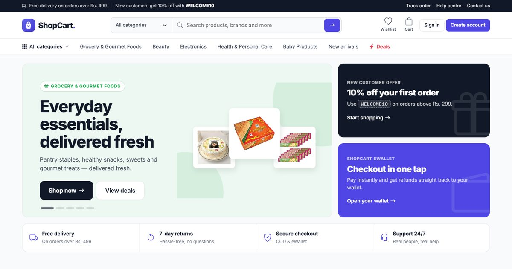
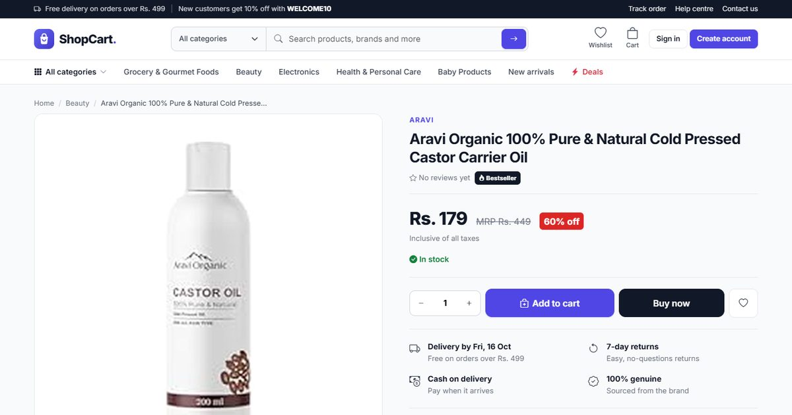
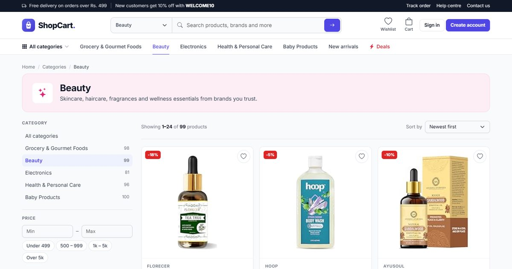
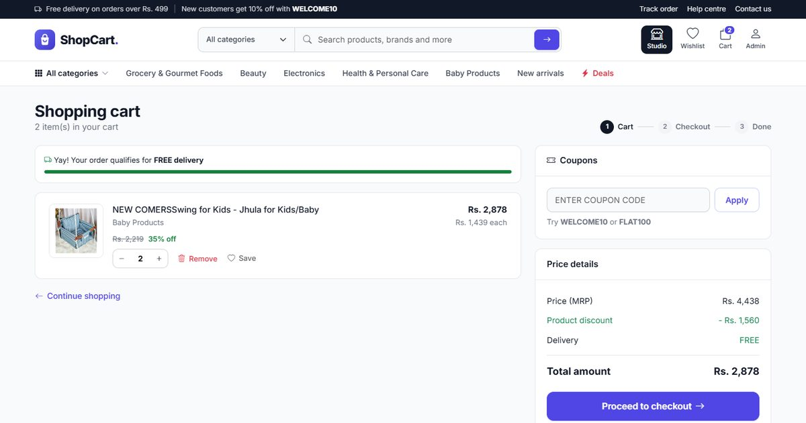
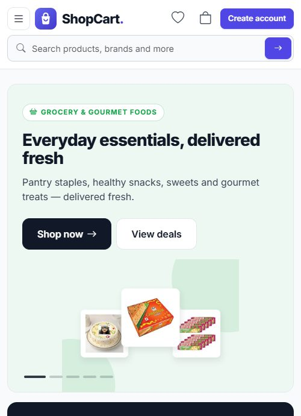
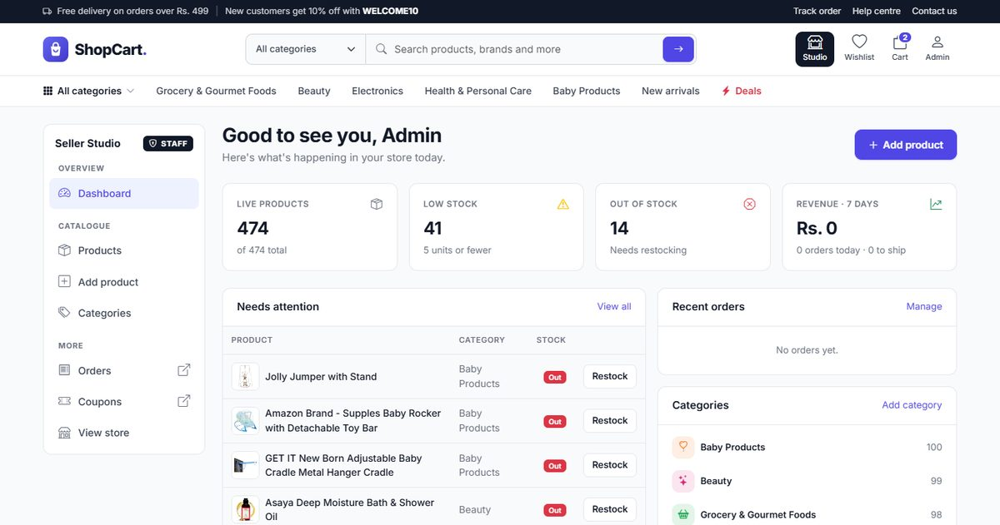
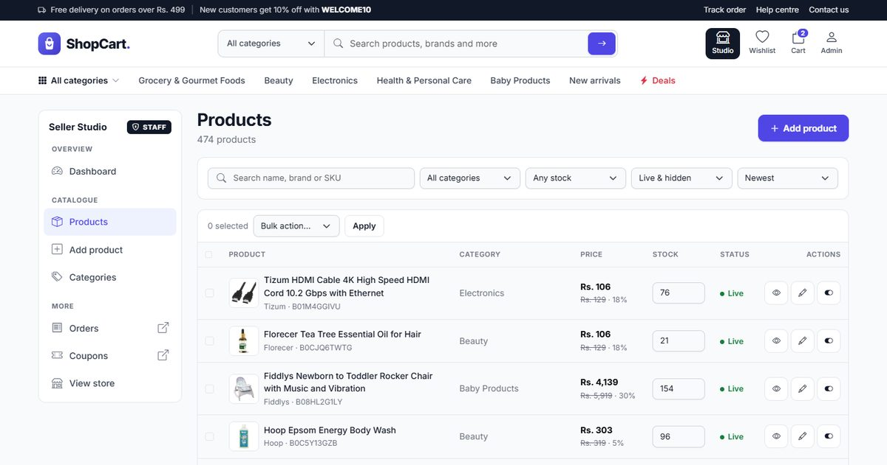
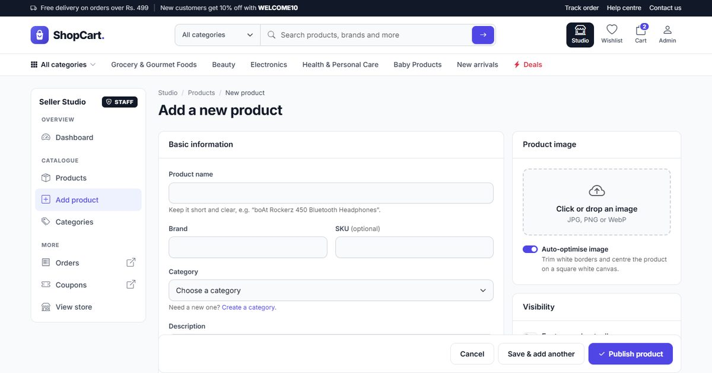

<div align="center">


# ShopCart

**A full-featured e-commerce store built with Django.**
Product catalogue, cart and checkout, orders, eWallet, reviews, and a staff-only Seller Studio for managing products.




</div>

---

## Contents

- [Features](#features)
- [Screenshots](#screenshots)
- [Tech stack](#tech-stack)
- [Getting started](#getting-started)
- [Seller Studio](#seller-studio)
- [Configuration](#configuration)
- [Adding a payment gateway](#adding-a-payment-gateway)
- [Management commands](#management-commands)
- [Running tests](#running-tests)
- [Project structure](#project-structure)
- [URL reference](#url-reference)

## Features

### Storefront
- **Home page:** category hero slider, bestsellers, a deals-of-the-day countdown, new arrivals, top brands and recently viewed products.
- **Shop and search:** filter by category, price, rating, stock and sale status. Six sort options, pagination, and live search suggestions with keyboard navigation.
- **Product pages:** brand, highlights, specifications, stock status, estimated delivery date, available offers, image zoom and related products.
- **Reviews and ratings:** star ratings with a breakdown chart and a *verified purchase* badge for customers whose order was delivered.
- **Wishlist:** save products with one click and move them to the cart later.
- **Responsive design:** a mobile slide-out menu and layouts tuned for phones, tablets and desktops.

### Cart and checkout
- Add to cart and update quantities without a page reload. The navbar counters update live.
- **Coupons:** percentage or flat discounts, with an optional minimum order, maximum discount, validity window and usage limit.
- **Free delivery** above a configurable order value, with a progress bar in the cart.
- **Saved addresses:** pick one at checkout or add a new one inline.
- **Payment methods:** Cash on Delivery and the ShopCart **eWallet**. An online gateway can be plugged in; see [Adding a payment gateway](#adding-a-payment-gateway).
- **Safe order placement:** stock rows are locked while an order is placed, so two customers can't buy the last unit.

### Orders and accounts
- Order history with status filters, a tracking timeline, cancel (with restock and an eWallet refund), *Buy again*, and a printable invoice.
- Profile with avatar, address book, password change, and password reset by email.
- **eWallet:** add money, withdraw, pay for orders and receive refunds. Every transaction is recorded in a ledger, and overdrafts are blocked.

### Administration
- **Seller Studio** (`/studio/`): a staff-only dashboard for managing the catalogue from the storefront. See [Seller Studio](#seller-studio).
- **Django admin** (themed with Jazzmin): order workflow actions (*confirm, ship, deliver, cancel and refund*), a low-stock filter, inline editing, and management of coupons, reviews, contact messages and newsletter subscribers.

## Screenshots

| Product page | Category listing |
|---|---|
|  |  |

| Shopping cart | Mobile |
|---|---|
|  |  |

| Studio: dashboard | Studio: products |
|---|---|
|  |  |

| Studio: add product |
|---|
|  |

## Tech stack

| Layer | Technology |
|---|---|
| Backend | Python 3.12, Django 5.1 |
| Database | SQLite (any Django-supported database works) |
| Frontend | Django templates, Bootstrap 5.3, Bootstrap Icons, vanilla JavaScript |
| Images | Pillow (automatic product-photo trimming and category cover generation) |
| Admin theme | django-jazzmin |

## Getting started

### Prerequisites
- Python 3.12+
- Git

### Installation

```bash
# 1. Clone the repository
git clone https://github.com/Sethumathavan2001/ShopCart-eCommerce-Django.git
cd ShopCart-eCommerce-Django

# 2. Create and activate a virtual environment
python -m venv venv
venv\Scripts\activate          # Windows
# source venv/bin/activate     # macOS / Linux

# 3. Install dependencies
pip install -r requirements.txt

# 4. Create the database
python manage.py migrate

# 5. Load the demo catalogue (5 categories, 474 products, 2 coupons)
python manage.py loaddata catalog

# 6. Create an admin account (also grants Seller Studio access)
python manage.py createsuperuser

# 7. Start the development server
python manage.py runserver
```

Then open **http://127.0.0.1:8000**.

| Page | URL |
|---|---|
| Storefront | http://127.0.0.1:8000/ |
| Seller Studio (staff only) | http://127.0.0.1:8000/studio/ |
| Django admin | http://127.0.0.1:8000/admin/ |

### Demo coupons

| Code | Discount | Minimum order |
|---|---|---|
| `WELCOME10` | 10% off (up to Rs. 200) | Rs. 299 |
| `FLAT100` | Rs. 100 off | Rs. 999 |

## Seller Studio

The Seller Studio is a hidden management area for staff users.

- The **Studio** button appears in the navbar **only for staff accounts** (`is_staff = True`).
- Every other visitor gets a plain **404** at `/studio/...`, so the area isn't discoverable.

What it includes:
- **Dashboard:** live and hidden product counts, low-stock and out-of-stock alerts, revenue for the last 7 days, and recent orders.
- **Products:** search, filter, sort, inline stock editing, and bulk show, hide, feature or delete.
- **Add and edit products:** drag-and-drop image upload with **auto-optimisation** (trims white borders and centres the product on a square canvas), a live preview of the product card, and price and stock validation.
- **Categories:** name, tagline, description, icon picker, accent colour and cover image.

To give an existing user access, tick **Staff status** on their account in Django admin, or run:

```bash
python manage.py shell -c "from django.contrib.auth.models import User; User.objects.filter(username='alice').update(is_staff=True)"
```

## Configuration

Settings are read from environment variables, with development defaults:

| Variable | Default | Purpose |
|---|---|---|
| `DJANGO_SECRET_KEY` | insecure development key | **Set this in production.** |
| `DJANGO_DEBUG` | `True` | Set to `False` in production. |
| `DJANGO_ALLOWED_HOSTS` | `127.0.0.1,localhost` | Comma-separated list of hostnames. |
| `DJANGO_EMAIL_BACKEND` | console backend | Use an SMTP backend to send real password-reset emails. |

Store behaviour is configured in [`eCommerce/settings.py`](eCommerce/settings.py):

```python
FREE_SHIPPING_ABOVE = 499        # Orders at or above this amount ship free
SHIPPING_CHARGE = 40             # Flat shipping fee below the threshold
MAX_QTY_PER_ITEM = 10            # Max units of one product per order
WALLET_MAX_TRANSACTION = 100000  # Max single wallet add / withdraw
ONLINE_PAYMENT_ENABLED = False   # Enable once a gateway is integrated
```

## Adding a payment gateway

Online payment (cards, UPI, netbanking) is designed to plug in without touching the rest of the checkout:

1. Implement the gateway in `payment_start` in [`shop/views.py`](shop/views.py). Its docstring lists the order fields to update on a verified payment (`payment_status`, `status`, `payment_reference`).
2. Render the gateway's checkout in [`shop/templates/payment.html`](shop/templates/payment.html).
3. Set `ONLINE_PAYMENT_ENABLED = True` to enable the option at checkout.

> **Note:** "Add money" in the eWallet currently credits the balance immediately. Once a gateway is integrated, credit the wallet only after the payment is confirmed.

## Management commands

| Command | Description |
|---|---|
| `python manage.py loaddata catalog` | Load the demo catalogue fixture. |
| `python manage.py import_products` | Import raw categories and products from `shop/data/*.csv`. |
| `python manage.py prepare_catalog` | Clean imported data: shorten titles, extract brands and SKUs, build highlights, set realistic prices and stock, remove duplicates, generate product and category images, and reconcile wallet balances. Safe to run repeatedly; add `--dry-run` to preview the changes. |

## Running tests

```bash
python manage.py test shop
```

The suite covers the catalogue, search, cart, coupons, wishlist, checkout (including stock locking and wallet rollback), order cancellation and refunds, the wallet, reviews, authentication, Seller Studio access control and uploads, and the catalogue-cleaning logic.

## Project structure

```
├── eCommerce/                  # Project settings and root URLs
├── shop/
│   ├── models.py               # Category, Product, Cart, Wishlist, Order, Coupon, Review, Wallet...
│   ├── views.py                # Storefront, cart, checkout, orders, account, wallet
│   ├── studio.py               # Seller Studio (staff-only) views
│   ├── services.py             # Cart totals, coupons, wallet credit/debit
│   ├── imaging.py              # Product-photo optimisation and category covers
│   ├── forms.py                # Customer and Studio forms
│   ├── admin.py                # Django admin configuration
│   ├── context_processors.py   # Cart / wishlist counts and categories for every page
│   ├── signals.py              # Auto-create user profiles
│   ├── templatetags/           # Rupee formatting, star ratings, querystring helpers
│   ├── management/commands/    # import_products, prepare_catalog
│   ├── fixtures/catalog.json   # Demo catalogue data
│   ├── templates/              # Storefront, account, studio and auth templates
│   └── tests.py
├── static/
│   ├── css/style.css           # Design system
│   ├── js/shop.js              # Cart, wishlist, live search, toasts
│   ├── images/                 # Logo, favicon, payment badges
│   ├── products/               # Optimised product images
│   └── categories/             # Generated category covers
├── docs/screenshots/           # Images used in this README
├── manage.py
└── requirements.txt
```

## URL reference

| Area | Routes |
|---|---|
| Catalogue | `/`, `/shop`, `/collection`, `/collectionview/<id>`, `/productdetail/<id>` |
| Cart & checkout | `/cart`, `/favorite`, `/checkout`, `/payment/<order>` |
| Orders | `/orders`, `/orders/<order>`, `/orders/<order>/invoice` |
| Account | `/login`, `/register`, `/account`, `/account/addresses`, `/account/password`, `/password-reset`, `/ewallet` |
| Seller Studio | `/studio/`, `/studio/products`, `/studio/products/add`, `/studio/categories` |
| Info | `/about`, `/faq`, `/contact`, `/policy/<terms\|privacy\|shipping\|returns>` |

---

<div align="center">

Built by **[Sethumathavan](https://github.com/Sethumathavan2001)**

</div>
